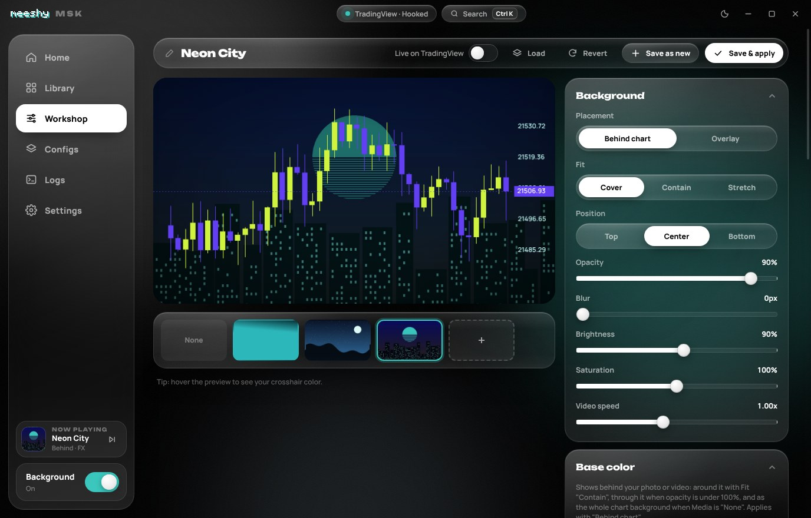

<p align="center">
  
</p>

<p align="center">
  <a href="../../releases/latest"></a>
  
  
  
</p>

<h3 align="center">The MSK desktop app: photo & video backgrounds, candle colors and animations for TradingView Desktop.</h3>
<p align="center">No account. No paywall. Runs on your PC.</p>

<p align="center">
  <b>Using TradingView in your browser instead?</b> Grab the extension → <a href="https://github.com/meeshyweeshy/msk-extension"><b>msk-extension</b></a>
</p>

<br />

<p align="center">
  
</p>

## ✦ App or extension?

| | 🖥️ **Desktop app** (this repo) | 🌐 **[Browser extension](https://github.com/meeshyweeshy/msk-extension)** |
|---|---|---|
| Works with | TradingView **Desktop** (Windows) | tradingview.com in Chrome · Brave · Edge |
| Install | Installer or portable ZIP | Load unpacked |
| Starts with Windows / tray | ✅ | – |
| Global hotkeys | ✅ anywhere in Windows | ✅ in the browser |
| Backgrounds, colors, animations, configs | ✅ | ✅ |
| Share configs | `.msk` files work in both | `.msk` files work in both |

## ✦ What it does

| | |
|---|---|
| 🖼️ **Backgrounds** | Any photo, GIF or video behind (or over) your chart. Fit, blur, brightness, saturation, tint, vignette. |
| 🎨 **Base color** | Solid, gradient or TradingView's own theme behind your media. Or no media, just color. |
| 🕯️ **Candle colors** | Bodies, borders, wicks, grid, scale text, crosshair. Presets included. |
| ✨ **Animations** | Pulse, flash, strobe, heartbeat, flicker, rainbow cycling, on basically anything. |
| 🗂️ **Configs** | Save looks, one-click switching, auto-rotate, export/import `.msk` (media included). |
| 🧰 **Quality of life** | Tray icon, launch at startup, global hotkeys, `Ctrl+K` command palette, light/dark theme. |
| ⬆️ **Updates** | Checks GitHub for new releases and tells you when one's out, with a one-click download. |
| 🐞 **Debug tools** | Live logs, diagnostics, launch test, process watcher, Kill All for stuck TradingView processes. |

## ✦ Preview

<table>
  <tr>
    <td width="50%"><p align="center"><b>Workshop</b>: build a look with a live preview</p></td>
    <td width="50%"><p align="center"><b>Configs</b>: all your looks in one place</p></td>
  </tr>
  <tr>
    <td colspan="2"><p align="center"><b>Settings</b>: TradingView hook status, launch method, hotkeys, debug</p></td>
  </tr>
</table>

## ✦ Install

1. Go to **[Releases](../../releases/latest)**.
2. Download **`MSK-Setup-x.x.x.exe`** (installer) or **`MSK-x.x.x-win-x64.zip`** (portable: unzip and run `MSK.exe`).
3. If Windows SmartScreen pops up: **More info → Run anyway** (the app isn't code-signed).
4. Open MSK. It finds TradingView Desktop and opens it hooked.

> If TradingView is already open, MSK asks to restart it so it can hook in. Use **Settings → Desktop shortcut** to get a "TradingView (MSK)" icon that always opens it hooked.

## ✦ How it hooks in

MSK starts TradingView Desktop with Chromium's debug switch (`--remote-debugging-port`, bound to `127.0.0.1` only), the same way other TradingView tools do, then injects its engine into the chart window. Nothing goes over the internet. Media is streamed straight from your disk.

Heads up: while that port is open, other programs on your PC could control TradingView too. It closes when TradingView closes.

## ✦ Hotkeys

| Keys | Does |
|---|---|
| `Ctrl` `Alt` `B` | Background on / off |
| `Ctrl` `Alt` `N` | Next config |
| `Ctrl` `Alt` `F` | Pause / resume animations |
| `Ctrl` `K` | Command palette (inside MSK) |

All changeable in **Settings → Hotkeys**.

## ✦ Build it yourself

```bash
npm install
npm start          # run in dev
npm run dist       # Windows installer + zip in dist/
npm run ext        # build the browser extension into dist/extension
```

Tagging a version (`git tag v1.2.0 && git push --tags`) builds the Windows release automatically with GitHub Actions.

## ✦ Troubleshooting

- **Says "Not hooked"**: Settings → TradingView → **Restart**, or **Kill all related processes** first.
- **Something's weird**: run `MSK Debug.cmd` (in the app folder) and check the **Logs** page, or **Run diagnostics**.
- **Candle colors didn't change**: make sure **Recolor the chart** is on in the Workshop. TradingView's internals aren't public, so colors are best-effort. Backgrounds always work.

## ✦ About

MSK started as a "can I put my own wallpaper behind TradingView?" idea and turned into a full chart-skins studio: this desktop app plus a [browser extension](https://github.com/meeshyweeshy/msk-extension). Built by **meeshy** for traders who stare at charts all day and want them to actually look good.

Not affiliated with TradingView.

<p align="center"></p>
