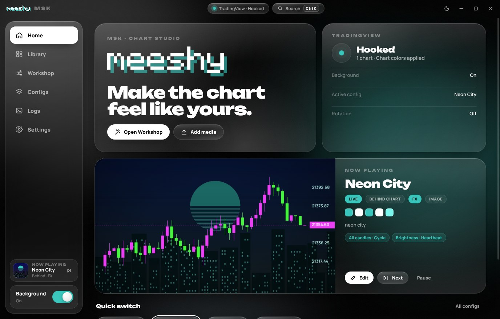
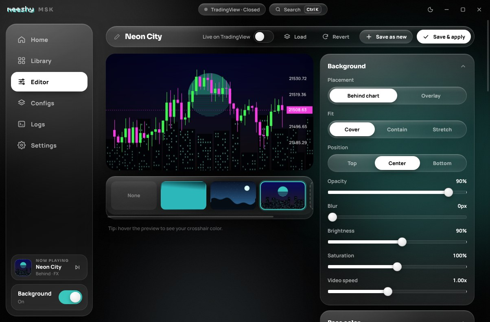
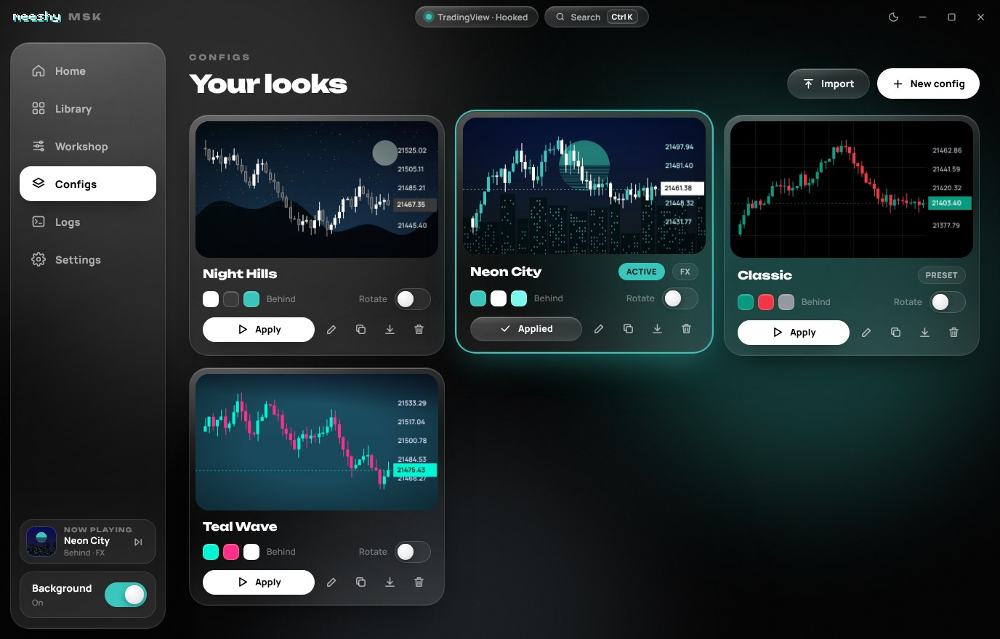
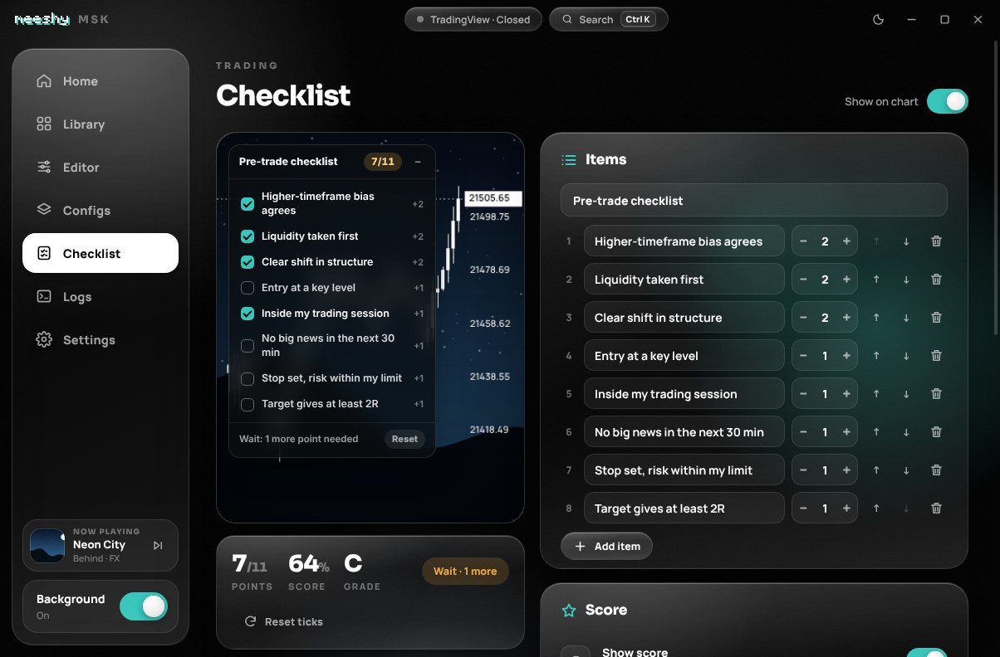
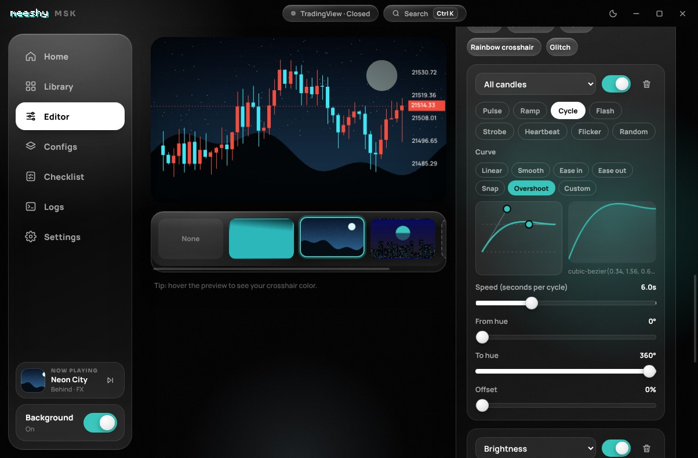
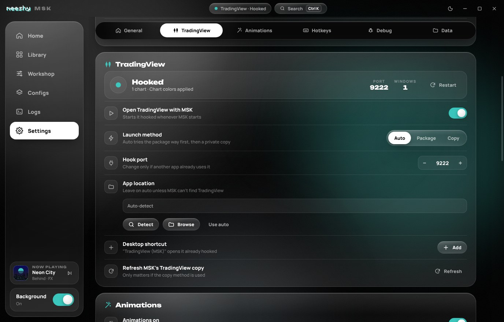
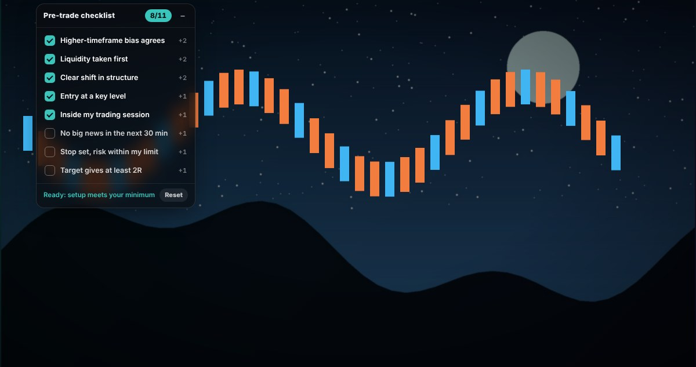

<p align="center">
  
</p>

<p align="center">
  <a href="../../releases/latest"></a>
  <a href="../../releases/latest"></a>
  
  
  
</p>

<h3 align="center">The MSK desktop app: photo & video backgrounds, candle colors and animations for TradingView Desktop.</h3>
<p align="center">No account. No paywall. Runs on your PC or Mac.</p>

<p align="center">
  <b>Using TradingView in your browser instead?</b> Grab the extension → <a href="https://github.com/meeshyweeshy/msk-extension"><b>msk-extension</b></a>
</p>

<br />

<p align="center">
  
</p>

## ✦ App or extension?

| | 🖥️ **Desktop app** (this repo) | 🌐 **[Browser extension](https://github.com/meeshyweeshy/msk-extension)** |
|---|---|---|
| Works with | TradingView **Desktop** on Windows & macOS | tradingview.com in Chrome · Brave · Edge |
| Install | Windows installer / ZIP · Mac `.dmg` | Load unpacked |
| Starts at login, lives in the tray / menu bar | ✅ | – |
| Global hotkeys | ✅ anywhere on your computer | ✅ in the browser |
| Backgrounds, colors, animations, configs | ✅ | ✅ |
| Share configs | `.msk` files work in both | `.msk` files work in both |

## ✦ What it does

| | |
|---|---|
| 🖼️ **Backgrounds** | Any photo, GIF or video behind (or over) your chart. Fit, blur, brightness, saturation, tint, vignette. |
| 🎨 **Base color** | Solid, gradient or TradingView's own theme behind your media. Or no media, just color. |
| 🕯️ **Candle colors** | Bodies, borders, wicks, grid, scale text, crosshair. Color palettes included. |
| ✨ **Animations** | Pulse, flash, strobe, heartbeat, flicker, rainbow cycling, on basically anything. |
| 〰️ **Curves** | Shape every animation with presets (Smooth, Snap, Overshoot…) or drag your own curve. |
| 📋 **Trading checklist** | A pre-trade checklist right on your chart. Tick items there or in MSK, get a score (points, percent or grade) and a Ready / Wait call against your minimum. |
| 🗂️ **Configs** | Starts with a clean Monochrome look. Save your own, one-click switching, auto-rotate, export/import `.msk` (media included). |
| 🌈 **Your colors** | Pick MSK's own accent, glow and background colors in **Settings → Appearance**. |
| 🧰 **Quality of life** | Tray / menu bar icon, launch at login, global hotkeys, `Ctrl+K` / `⌘K` command palette, light/dark theme. |
| ⬆️ **Updates** | Checks GitHub for new releases and tells you when one's out, with a one-click download. |
| 🐞 **Debug tools** | Live logs, diagnostics, launch test, Kill All for stuck TradingView processes. |

## ✦ Preview

<table>
  <tr>
    <td width="50%"><p align="center"><b>Editor</b>: build a look with a live preview</p></td>
    <td width="50%"><p align="center"><b>Configs</b>: all your looks in one place</p></td>
  </tr>
  <tr>
    <td width="50%"><p align="center"><b>Checklist</b>: your pre-trade rules with a score</p></td>
    <td width="50%"><p align="center"><b>Curves</b>: drag the dots to shape an animation</p></td>
  </tr>
  <tr>
    <td colspan="2"><p align="center"><b>Settings</b>: your own app colors, TradingView status, hotkeys, debug</p></td>
  </tr>
</table>

<p align="center"><br /><sub>The trading checklist on your chart: tick items, watch the score, drag it anywhere</sub></p>

## ✦ Install

Everything's on the **[Releases](../../releases/latest)** page.

### 🪟 Windows

1. Download **`MSK-Setup-x.x.x.exe`** (installer) or **`MSK-x.x.x-win-x64.zip`** (portable: unzip and run `MSK.exe`).
2. If Windows SmartScreen pops up: **More info → Run anyway** (the app isn't code-signed).
3. Open MSK. It finds TradingView Desktop and opens it hooked.

> Use **Settings → Desktop shortcut** to get a "TradingView (MSK)" icon that always opens it hooked.

### 🍎 macOS

1. Download the `.dmg` for your Mac:
   - **`MSK-x.x.x-mac-arm64.dmg`**: Apple Silicon (M1, M2, M3, M4…)
   - **`MSK-x.x.x-mac-x64.dmg`**: Intel Macs
   
   Not sure? Apple menu → **About This Mac**. "Chip: Apple M…" means arm64.
2. Open the dmg and drag **MSK** into **Applications**.
3. First launch: the app isn't notarized by Apple, so macOS blocks it once.
   - Open MSK, click **Done** on the warning, then go to **System Settings → Privacy & Security**, scroll down and click **Open Anyway**.
   - Or in Terminal: `xattr -dr com.apple.quarantine /Applications/MSK.app`
4. Open MSK. It finds TradingView in `/Applications` and opens it hooked.

> On older macOS (Sonoma and before) you can also just right-click MSK → **Open** the first time.

If TradingView is already open, MSK asks to restart it so it can hook in.

## ✦ How it hooks in

MSK starts TradingView Desktop with Chromium's debug switch (`--remote-debugging-port`, bound to `127.0.0.1` only), the same way other TradingView tools do, then injects its engine into the chart window. Nothing goes over the internet. Media is streamed straight from your disk.

Heads up: while that port is open, other programs on your computer could control TradingView too. It closes when TradingView closes.

## ✦ Hotkeys

| Windows | macOS | Does |
|---|---|---|
| `Ctrl` `Alt` `B` | `⌘` `⌥` `B` | Background on / off |
| `Ctrl` `Alt` `N` | `⌘` `⌥` `N` | Next config |
| `Ctrl` `Alt` `F` | `⌘` `⌥` `F` | Pause / resume animations |
| `Ctrl` `Alt` `C` | `⌘` `⌥` `C` | Show / hide the checklist |
| `Ctrl` `K` | `⌘` `K` | Command palette (inside MSK) |

All changeable in **Settings → Hotkeys**.

## ✦ Build it yourself

```bash
npm install
npm start          # run in dev
npm run dist       # Windows installer + zip in dist/
npm run dist-mac   # macOS dmg + zip, arm64 and x64 (run on a Mac)
npm run ext        # build the browser extension into dist/extension
```

**Releases are automatic:** bump `"version"` in `package.json` and push to `main`. GitHub Actions builds the Windows installer and zip, the Mac dmgs and zips and the extension zip, and publishes them as a new Release, and everyone's app sees the update.

## ✦ Troubleshooting

- **Says "Not hooked"**: Settings → TradingView → **Restart**, or **Kill all related processes** first.
- **Something's weird**: start MSK in debug mode and check the **Logs** page, or **Run diagnostics**.
  - Windows: run `MSK Debug.cmd` (in the app folder).
  - macOS: `open -n -a MSK --args --msk-debug` in Terminal.
- **Mac says MSK "is damaged" or "can't be opened"**: that's the missing Apple notarization, not actual damage. See step 3 of the macOS install.
- **Candle colors didn't change**: make sure **Recolor the chart** is on in the Editor. TradingView's internals aren't public, so colors are best-effort. Backgrounds always work.

## ✦ Terms & disclaimer

MSK is free and provided **as-is, with no warranty**. It only changes how your chart looks and **isn't financial advice**. I'm not liable for trading losses, account problems, data loss or anything else that comes from using it. By downloading or using MSK you agree to the **[Terms of Service](TERMS.md)**.

## ✦ About

MSK started as a "can I put my own wallpaper behind TradingView?" idea and turned into a full chart-skins studio: this desktop app plus a [browser extension](https://github.com/meeshyweeshy/msk-extension). Built by **meeshy** for traders who stare at charts all day and want them to actually look good.

Not affiliated with or endorsed by TradingView, Inc. See the [Terms of Service](TERMS.md).

<p align="center"></p>
